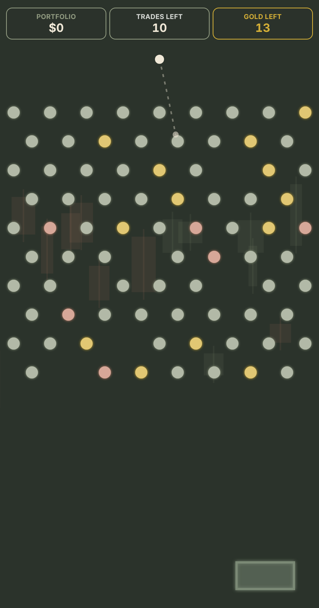
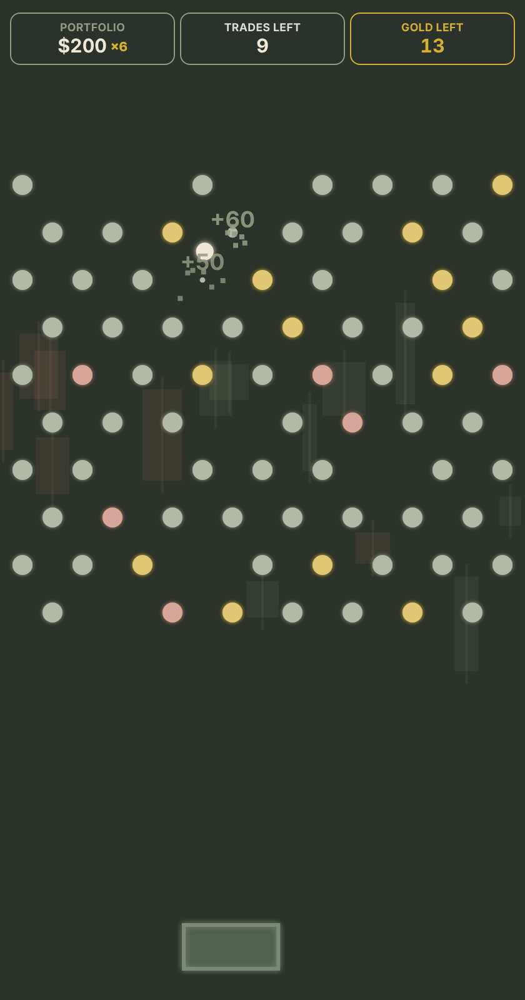

# Profit Plinko

A Peggle-style browser game built for [AlignedFX](https://alignedfx.com), a trading psychology brand. Each ball is a "trade": aim, launch, and clear the gold chips before you run out of trades.

<p align="center">
  
  &nbsp;&nbsp;&nbsp;
  
</p>

**Play it:** [alignedfx.com/profit-plinko](https://alignedfx.com/profit-plinko)

## How it plays

- Aim with the pointer and launch. A gravity-aware preview line shows the ball's path.
- Hitting gold chips clears them. Consecutive hits build a combo multiplier (up to ×20) on your portfolio score.
- A moving bucket at the bottom returns the trade if you catch it.
- Time slows and the camera zooms in when the ball closes in on the last chips.
- Clear every gold chip to move on to the next round.

The idea behind it: you control the setup and the execution, and probability handles the rest.

## Technical notes

- Plain HTML, CSS and JavaScript on the Canvas 2D API. No framework, no build step, no dependencies.
- Custom physics: gravity, friction, wall bounce, peg collision, and a fixed-timestep game loop for consistent behavior across refresh rates.
- Responsive board that remaps pegs on resize or rotation and scales for high-DPI screens.
- Sound effects generated in code with the Web Audio API.
- Respects `prefers-reduced-motion` by turning off screen shake and flashes.
- Built to be embedded in an iframe on the AlignedFX site.

## Run locally

Clone the repo and open `index.html` in a browser, or serve the folder:

```bash
npx serve .
```

## Files

| File | Purpose |
|------|---------|
| `index.html` | Page shell, menu and HUD |
| `style.css` | Layout and brand styling |
| `game.js` | Game loop, physics, rendering, audio |

---

© Shaynah / AlignedFX. All rights reserved. The code is public for portfolio viewing.
